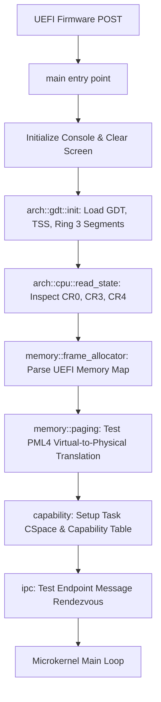

# Kernel Entry Point & Bootstrapping Documentation

- **Source File**: [`src/main.rs`](file:///d:/os/src/main.rs)
- **Subsystem**: Microkernel Bootstrap & Initialization Orchestrator

---

## 1. Conceptual Overview

[`src/main.rs`](file:///d:/os/src/main.rs) is the primary entry point executed when the UEFI firmware finishes hardware Power-On Self-Test (POST) and transfers control to `BOOTX64.EFI`.

Because Hydra targets native 64-bit UEFI directly:
- The CPU is already in **64-bit Long Mode**.
- Paging is enabled by the UEFI firmware.
- The kernel receives a valid `uefi::prelude::SystemTable` reference, enabling it to access firmware services before taking full ownership of the machine.

---

## 2. Boot Execution Pipeline



---

## 3. Step-by-Step Code Walkthrough

### The Panic Handler
```rust
#[panic_handler]
fn panic(_info: &PanicInfo) -> ! {
    console::set_color(Color::LightRed, Color::Black);
    println!("\n[!] KERNEL PANIC: {:?}", _info);
    loop {}
}
```
If an assertion fails or an unexpected unrecoverable condition occurs, the panic handler prints diagnostic error messages in red to the console and halts the CPU in a safe infinite loop.

---

### Step 1: Segmentation & Hardware Privilege Setup
```rust
arch::gdt::init();
```
Installs Hydra's custom Global Descriptor Table and Task State Segment, configuring the CPU for both supervisor (Ring 0) and isolated userland (Ring 3) execution.

---

### Step 2: CPU Diagnostics
```rust
let cpu = arch::cpu::read_state();
```
Reads control registers to log the active hardware configuration, including the physical address of the initial root page table (`CR3`).

---

### Step 3: Physical Memory Discovery
```rust
memory::frame_allocator::init_memory_from_uefi();
```
Queries UEFI firmware for the memory map, identifies all conventional RAM regions, and initializes the kernel's physical frame allocator. Allocates a sample 4 KiB frame to verify operation.

---

### Step 4: Virtual Memory Verification
```rust
let address_space = memory::paging::AddressSpace::active();
let sample_virt = VirtAddr::new(main as *const () as usize as u64);
let sample_phys = unsafe { address_space.translate_addr(sample_virt) };
```
Walks the active 4-level PML4 page table hierarchy to verify that virtual addresses successfully resolve to physical memory frames.

---

### Step 5: Capability Table Initialization
```rust
let mut cap_table = CapabilityTable::new();
let root_cap = Capability::new(CapType::AddressSpace { root_cr3: cpu.cr3_frame.as_u64() }, Rights::ALL);
let ep_cap = Capability::new(CapType::Endpoint { endpoint_id: 1 }, Rights(Rights::READ.0 | Rights::WRITE.0 | Rights::CALL.0));
cap_table.insert(root_cap).unwrap();
cap_table.insert(ep_cap).unwrap();
```
Establishes the process capability table (CSpace), assigning granular access tokens to kernel resources.

---

### Step 6: Microkernel IPC Rendezvous
```rust
let mut endpoint = Endpoint::new(1);
let msg = Message::with_args(0x1001, [42, 1337, 0, 0]).with_cap(ep_cap);
endpoint.send(msg).unwrap();
let received = endpoint.receive();
```
Demonstrates inter-process communication: sending a message with inline arguments and an attached delegated capability, followed by receiving and consuming the message from the endpoint.
