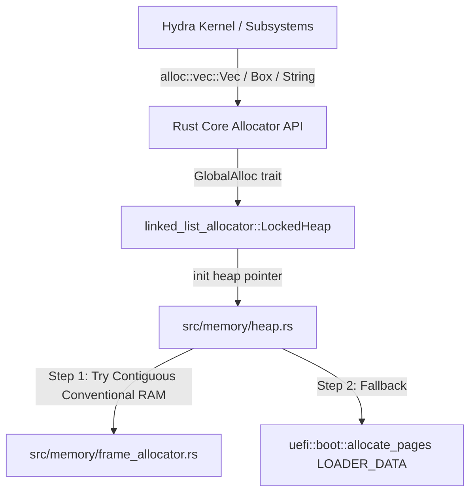

# Dynamic Kernel Heap Allocator Documentation

- **Source File**: [`src/memory/heap.rs`](file:///d:/os/src/memory/heap.rs)
- **Subsystem**: Dynamic Memory Management & Global Allocator (`alloc` crate)

---

## 1. Conceptual Overview

Operating system kernels initially boot in an environment where standard dynamic allocation (`malloc` or `new`) is unavailable. All structures must fit into static arrays or the stack.

The **Dynamic Kernel Heap Allocator** bridges this gap:
- It carves out a designated region of physical/virtual RAM (default: **8 MiB**, 2048 contiguous 4 KiB pages).
- It binds this region to Rust's standard allocation interface via `#[global_allocator]`.
- It enables the Rust `extern crate alloc;` library across the entire Hydra codebase, unlocking idiomatic heap collections: `Vec`, `String`, `Box`, `Arc`, and `BTreeMap`.

---

## 2. Allocation Architecture



### Allocation Pipeline:
1. **Physical Backing Allocation**:
   - `heap::init()` requests a contiguous block of 2,048 physical 4 KiB frames from `FRAME_ALLOCATOR.lock().allocate_contiguous_frames(...)`.
   - If not yet ready, it falls back to UEFI firmware `allocate_pages`.
2. **Zero-Initialization**:
   - Memory is zero-cleared to avoid dirty residual data.
3. **LinkedList Allocator Hookup**:
   - `HEAP_ALLOCATOR.lock().init(start_ptr, HEAP_SIZE)` configures the free-list structures.
4. **Self-Test Verification**:
   - `heap::self_test()` validates `Box` allocation, multiple `Vec` capacity expansions, `alloc::format!` string formatting, and checks that memory is fully reclaimed upon RAII drops.

---

## 3. Public API Breakdown

| Function | Signature | Description |
| :--- | :--- | :--- |
| `init()` | `fn() -> Result<HeapStats, &'static str>` | Initializes the global heap allocator using contiguous physical memory. |
| `is_initialized()` | `fn() -> bool` | Checks if dynamic allocations are currently safe to execute. |
| `stats()` | `fn() -> HeapStats` | Queries current heap metrics (start address, total bytes, used bytes, free bytes). |
| `self_test()` | `fn() -> Result<(), &'static str>` | Executes regression tests validating `Box`, `Vec`, `String`, and RAII deallocation without leaks. |

---

## 4. Interactive Shell Inspection

Hydra provides real-time shell commands to monitor and test the heap:

```text
hydra> mem
Physical Memory Manager Statistics:
  Total Usable RAM:   ...
Dynamic Kernel Heap Allocator:
  Heap Status:        ONLINE
  Start Address:      0x...
  Total Heap Size:    8388608 bytes (8 MiB)
  Used Heap Memory:   ...
  Free Heap Memory:   ...

hydra> heap stats
Dynamic Kernel Heap Statistics:
  Status:             ONLINE
  Base Physical/Virt: 0x...
  Total Size:         8388608 bytes (8 MiB)
  Heap Utilization:   0%

hydra> heap test
[*] Running dynamic heap allocation self-test suite...
[+] Heap self-test PASSED:
    - Box<u64> heap allocation & dereference verified
    - Vec<usize> dynamic buffer reallocation (1,000 items) verified
    - alloc::format! dynamic string verified
    - RAII drop cleanup verified without memory leaks
```
