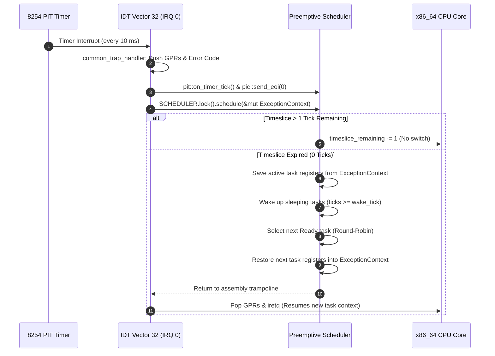

# Preemptive Multitasking & Context Switching

## Overview

The Hydra multitasking subsystem implements a **preemptive round-robin scheduler** driven by the 8254 Programmable Interval Timer (PIT) firing at 100 Hz on IDT Vector 32 (IRQ 0). Multitasking enables concurrent execution of independent kernel threads, background worker tasks, and the interactive shell with transparent hardware context switching.

The implementation resides in [`src/task/scheduler.rs`](file:///d:/os/src/task/scheduler.rs), with the public API exposed through [`src/task/mod.rs`](file:///d:/os/src/task/mod.rs) and interactive shell commands in [`src/shell/commands/task_cmds.rs`](file:///d:/os/src/shell/commands/task_cmds.rs).

---

## Scheduling Architecture & Timeslicing

The scheduler operates on a fixed timeslice quantum of **5 PIT timer ticks (50 ms)** at 100 Hz.



### Scheduling Algorithm Details

1. **Sleep Accounting**: On every tick, the scheduler scans all registered tasks and transitions any task in `TaskState::Sleeping { wake_tick }` back to `TaskState::Ready` if the current PIT tick count has reached or exceeded `wake_tick`.
2. **Timeslice Depletion**: The currently running task has its `ticks_run` counter incremented and `timeslice_remaining` decremented. If more than 1 tick remains in its timeslice, the scheduler returns immediately without context switching.
3. **Round-Robin Selection**: When the timeslice expires, the outgoing task's registers and `CR3` paging root are saved from `ExceptionContext`. The run-queue is scanned in two passes:
   - **Pass 1 (Normal & High Priority)**: Scans for the next runnable non-idle task (`priority > Idle`).
   - **Pass 2 (Idle Fallback)**: If no normal tasks are ready, schedules Task 1 (`idle`) to execute low-power CPU halts (`hlt`).
4. **Context Switch Restoration**: The chosen task's registers are written back into `ExceptionContext`, its timeslice is reset to 50 ms, and if the task has a distinct `CR3` page table, the CPU paging root is updated via `Cr3::write()`.

---

## Hardware Context Switching via `iretq`

Hydra employs an in-place stack frame modification pattern for architectural context switching:

1. When IRQ 0 fires, the CPU pushes `SS`, `RSP`, `RFLAGS`, `CS`, and `RIP` onto the active stack.
2. The assembly entry point `common_trap_handler` pushes all fifteen general-purpose registers (`RAX` through `R15`) and points `RSP` to the `ExceptionContext`.
3. `SCHEDULER.lock().schedule(ctx)` modifies the values stored inside the `ExceptionContext` on the stack.
4. As `common_trap_handler` unwinds, `pop r15..rax` loads the incoming task's general-purpose registers.
5. The hardware `iretq` instruction pops `RIP`, `CS`, `RFLAGS`, `RSP`, and `SS`. In 64-bit long mode, `iretq` unconditionally pops `RSP` and `SS` regardless of privilege level, atomically switching execution to the new task's stack and instruction pointer.

---

## Task Trampoline & Calling Conventions

When a newly spawned kernel thread starts execution for the first time, it does not resume from a previously interrupted state. Instead, it enters through the **Task Trampoline**:

```rust
extern "C" fn task_trampoline(entry_fn_addr: usize) -> ! {
    let func: fn() = unsafe { core::mem::transmute(entry_fn_addr) };
    func();

    // Mark task Dead upon normal function exit and yield CPU
    crate::task::exit();
}
```

### ABI Alignment & Register Conventions

- **Win64 vs SysV Dual Argument Passing**: Under the UEFI target (`x86_64-unknown-uefi`), the Microsoft x64 calling convention passes the first function argument in **`RCX`** (in contrast to SysV AMD64, which uses `RDI`). `spawn_internal` initializes both `regs.rcx` and `regs.rdi` to the entry point address to guarantee cross-ABI compatibility.
- **Shadow Space & 16-Byte Stack Alignment**: The initial stack pointer is configured as `initial_rsp = stack_top.saturating_sub(48)`. This satisfies the mandatory 32-byte Microsoft x64 shadow spill space requirement and aligns the stack to a 16-byte boundary upon entry into `func()`.

---

## Background Idle Thread (`idle`)

Task 1 is initialized as the background `idle` thread with `TaskPriority::Idle` (Priority 0):

```rust
fn idle_task_entry() {
    loop {
        if x86_64::instructions::interrupts::are_enabled() {
            x86_64::instructions::hlt();
        } else {
            core::hint::spin_loop();
        }
    }
}
```

When no worker threads or shell tasks are runnable, the CPU enters the low-power halt state (`hlt`). The next timer tick or PS/2 keyboard interrupt automatically wakes the core to evaluate task readiness.

---

## Public Multitasking API

The [`src/task/mod.rs`](file:///d:/os/src/task/mod.rs) module provides a unified public interface for thread management:

| Function | Signature | Description |
| :--- | :--- | :--- |
| `init` | `fn init(current_cr3: u64)` | Initializes scheduler, creates Task 0 (`shell`), and spawns Task 1 (`idle`). |
| `is_active` | `fn is_active() -> bool` | Returns true if the multitasking subsystem is active. |
| `spawn` | `fn spawn(name, entry_fn, priority) -> TaskId` | Spawns a new concurrent kernel thread with a 16 KiB stack. |
| `yield_now` | `fn yield_now()` | Cooperatively relinquishes the remaining timeslice to the next task. |
| `sleep_ms` | `fn sleep_ms(ms: u64)` | Suspends the calling task for a duration in milliseconds. |
| `sleep_ticks` | `fn sleep_ticks(ticks: u64)` | Suspends the calling task for a specific number of 10ms PIT ticks. |
| `exit` | `fn exit() -> !` | Marks the calling task as `Dead` and yields the CPU permanently. |
| `kill` | `fn kill(id: TaskId) -> bool` | Terminates an active background thread by its Task ID. |
| `get_task_snapshots` | `fn get_task_snapshots() -> Vec<TaskSnapshot>` | Captures diagnostic thread telemetry for shell commands. |

---

## Shell Commands for Task Inspection & Control

Three built-in commands provide runtime task management in the interactive shell:

### 1. `ps` / `tasks` / `threads`
Displays all registered tasks, thread states, priorities, CPU tick consumption, and stack pointers:

```text
hydra:/bin> ps
PID   NAME             STATE        PRIORITY        TICKS        STACK (RSP)
---------------------------------------------------------------------------
0     shell            Running      Normal              0 0x0000000000000000
1     idle             Ready        Idle                0 0x00000000017a3150
2     bg_worker        Ready        Normal              0 0x00000000017a8950
---------------------------------------------------------------------------
Total tasks: 3 | Timeslice: 50 ms | Worker counter: 0
```

### 2. `spawn [worker]`
Spawns a new concurrent background kernel thread executing a counter loop with `task::sleep_ms(100)`.

```text
hydra:/bin> spawn worker
[+] Spawned background worker task #2 ('bg_worker').
    Type 'ps' to observe the task executing concurrently.
```

### 3. `kill <pid>`
Terminates an active background task by its numeric PID (system tasks PID 0 `shell` and PID 1 `idle` are protected from termination):

```text
hydra:/bin> kill 2
[+] Task #2 terminated.
```
