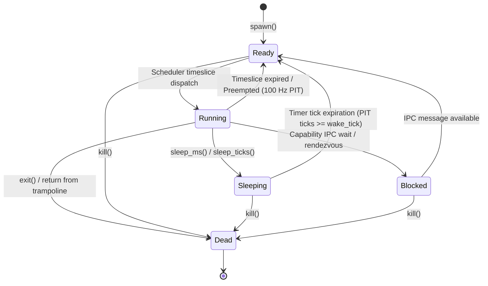

# Task Control Block (TCB) & Thread State

## Overview

The **Task Control Block (`Task` / `TCB`)** forms the foundational abstraction of thread execution and process representation in the Hydra 64-bit microkernel. Each execution thread is managed through an independent TCB that encapsulates its unique 64-bit identifier (`TaskId`), descriptive thread label, lifecycle execution state (`TaskState`), scheduling priority (`TaskPriority`), architectural register frame (`TaskRegisters`), dedicated 16 KiB execution stack, CPU tick consumption statistics, and an isolated per-task capability security space (`CapabilityTable`).

The implementation is located in [`src/task/tcb.rs`](file:///d:/os/src/task/tcb.rs) with public re-exports in [`src/task/mod.rs`](file:///d:/os/src/task/mod.rs).

---

## Architectural Context Frame (`TaskRegisters`)

When preemptive multitasking switches between tasks, the CPU architectural state must be preserved and restored with bit-exact fidelity. The `TaskRegisters` structure encapsulates all x86_64 general-purpose registers, the instruction pointer (`RIP`), code segment selector (`CS`), processor flags (`RFLAGS`), stack pointer (`RSP`), stack segment selector (`SS`), and the 4-level paging root (`CR3`).

```rust
#[repr(C)]
#[derive(Debug, Clone, Copy)]
pub struct TaskRegisters {
    pub r15: u64,
    pub r14: u64,
    pub r13: u64,
    pub r12: u64,
    pub rbp: u64,
    pub rbx: u64,
    pub r11: u64,
    pub r10: u64,
    pub r9: u64,
    pub r8: u64,
    pub rdi: u64,
    pub rsi: u64,
    pub rdx: u64,
    pub rcx: u64,
    pub rax: u64,
    pub rip: u64,
    pub cs: u64,
    pub rflags: u64,
    pub rsp: u64,
    pub ss: u64,
    pub cr3: u64,
}
```

### Context Synchronization

Two symmetric methods bridge the gap between hardware interrupt frames and the kernel's scheduler data structures:

1. **`save_from_context(&mut self, ctx: &ExceptionContext, cr3: u64)`**:
   Captures the running thread's state directly from the stack-saved `ExceptionContext` created by the assembly interrupt gate trampoline, recording the current `CR3` paging root.

2. **`restore_to_context(&self, ctx: &mut ExceptionContext)`**:
   Transfers the incoming thread's register frame into the active interrupt context frame on the stack. When the hardware interrupt routine exits via `iretq`, the CPU immediately restores all general-purpose registers and atomically resumes execution inside the new task.

---

## Thread Lifecycle State Machine (`TaskState`)

Each kernel task transitions across five discrete states during its execution lifecycle:



### State Definitions

| State | Description | Transition Trigger |
| :--- | :--- | :--- |
| **`Ready`** | Thread is runnable and waiting in the run-queue for CPU allocation. | Task creation, timeslice preemption, or sleep expiration. |
| **`Running`** | Thread currently owns the CPU core and is executing instructions. | Selected by the scheduler during context switch. |
| **`Sleeping { wake_tick }`** | Thread is suspended until the hardware PIT tick counter reaches `wake_tick`. | Invocation of `sleep_ms()` or `sleep_ticks()`. |
| **`Blocked`** | Thread is waiting on a capability-mediated IPC message or resource lock. | Synchronous IPC rendezvous request. |
| **`Dead`** | Thread has finished execution or was explicitly terminated by PID. | Invocation of `exit()` or administrative `kill()`. |

---

## Task Priority Levels (`TaskPriority`)

Hydra supports three distinct priority strata:

1. **`High` (Priority 2)**: Time-critical device drivers and real-time event handlers.
2. **`Normal` (Priority 1)**: Standard userland processes, shell sessions, and background workers.
3. **`Idle` (Priority 0)**: Lowest priority; assigned exclusively to Task 1 (`idle`). It is only scheduled when no other `Ready` thread exists in the system.

---

## Task Control Block Layout

```rust
pub struct Task {
    pub id: TaskId,
    pub name: &'static str,
    pub state: TaskState,
    pub priority: TaskPriority,
    pub regs: TaskRegisters,
    pub stack: Option<Box<[u8]>>,
    pub ticks_run: u64,
    pub timeslice_remaining: u32,
    pub cspace: Box<CapabilityTable>,
}
```

### Memory Footprint Optimization & Stack Safety

- **Heap-Allocated CSpace**: The `CapabilityTable` provides 256 capability slots (~8 KiB). In early designs, allocating this structure inline inside `Task` by value resulted in stack overflows during task creation. By storing `cspace: Box<CapabilityTable>`, the memory footprint of `Task` on the stack is reduced from **8,256 bytes to ~168 bytes**, guaranteeing zero stack smashing during deep call chains.
- **Dedicated 16 KiB Kernel Stacks**: Newly spawned threads allocate `16,384 bytes` (`16 KiB`) on the 8 MiB kernel heap. The top of the stack is 16-byte aligned (`(stack_top & !0xF)`), and an initial 48-byte shadow space offset is reserved to satisfy Microsoft x64 / UEFI and SysV AMD64 calling convention requirements.
