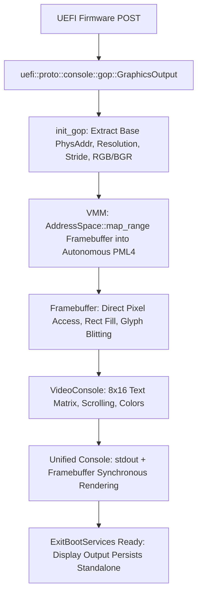

# Hardware Video Driver & GOP Framebuffer Documentation

- **Source Module**: [`src/video/`](file:///d:/os/src/video/)
- **Subsystem**: Display Driver, Linear Framebuffer & Autonomous Video Console

---

## 1. Conceptual Overview

Before an operating system can terminate firmware boot services (`ExitBootServices`), it must take complete ownership of the hardware display. Otherwise, text and graphics output will terminate with the firmware.

Hydra's video subsystem:
1. Discovers the **UEFI Graphics Output Protocol (GOP)** while boot services are active.
2. Retrieves the hardware's 32-bit linear physical framebuffer pointer, resolution (e.g. 1024x768 or native display), stride, and pixel format (`Rgb8` or `Bgr8`).
3. Uses Hydra's Virtual Memory Manager ([`AddressSpace::map_range`](file:///d:/os/src/memory/paging.rs#L311)) to map the entire physical framebuffer into Hydra's autonomous PML4 page table.
4. Integrates a lightweight **8x16 bitmap font engine** covering all printable ASCII characters.
5. Runs an **autonomous text-mode terminal emulator** directly on the pixel buffer, enabling `print!`, `println!`, colors, line wrapping, and hardware-accelerated vertical scrolling independent of UEFI firmware.

---

## 2. Video Architecture & Data Flow



---

## 3. Module Breakdown

| Source File | Role & Implementation |
| :--- | :--- |
| [`src/video/gop.rs`](file:///d:/os/src/video/gop.rs) | Hardware discovery via UEFI GOP, physical framebuffer extraction, and VMM page mapping. |
| [`src/video/font.rs`](file:///d:/os/src/video/font.rs) | 8x16 ASCII bitmap font table covering characters 32 to 126. |
| [`src/video/framebuffer.rs`](file:///d:/os/src/video/framebuffer.rs) | Direct linear pixel buffer controller: `put_pixel`, `fill_rect`, `clear`, `draw_char`, `draw_string`, and `scroll_up` (`core::ptr::copy`). |
| [`src/video/console.rs`](file:///d:/os/src/video/console.rs) | Autonomous text terminal running on the pixel buffer. Implements `core::fmt::Write`, cursor management, line wrapping, and color mapping. |
| [`src/video/mod.rs`](file:///d:/os/src/video/mod.rs) | Video subsystem coordinator and public API exports. |

---

## 4. Interactive Shell Inspection & Testing

Hydra provides the `video` (aliases: `gop`, `fb`) command in the shell:

```text
hydra> video info
Hardware Video Subsystem & Framebuffer Statistics:
  Driver Status:      ONLINE (Direct GOP Linear Framebuffer)
  Resolution:         1024 x 768 pixels (32 bpp)
  Pixel Stride:       1024 pixels/scanline (4096 bytes)
  Pixel Encoding:     BGR888 (Little-Endian)
  Video Memory Base:  0xe0000000
  Framebuffer Size:   3145728 bytes (3 MiB)
  Text Terminal Grid: 128 columns x 48 rows (8x16 font)
  Kernel VMM Status:  Identity-mapped in Hydra Autonomous PML4

hydra> video test
[+] Graphical test pattern & Wayland preview window rendered to screen.

hydra> video clear
[+] Framebuffer display cleared.
```
